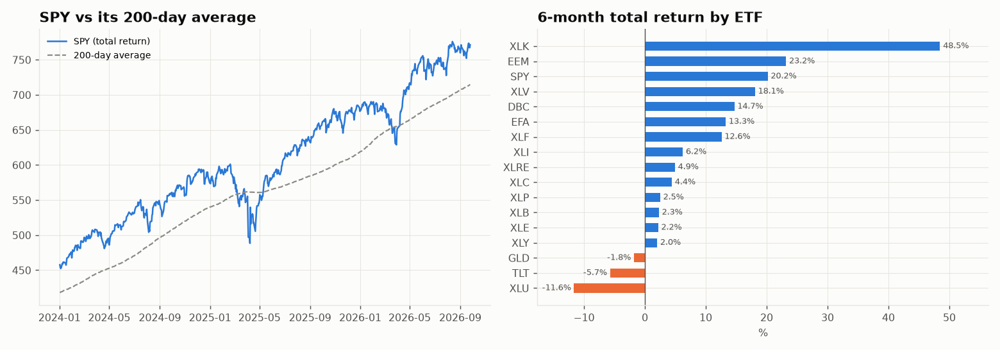
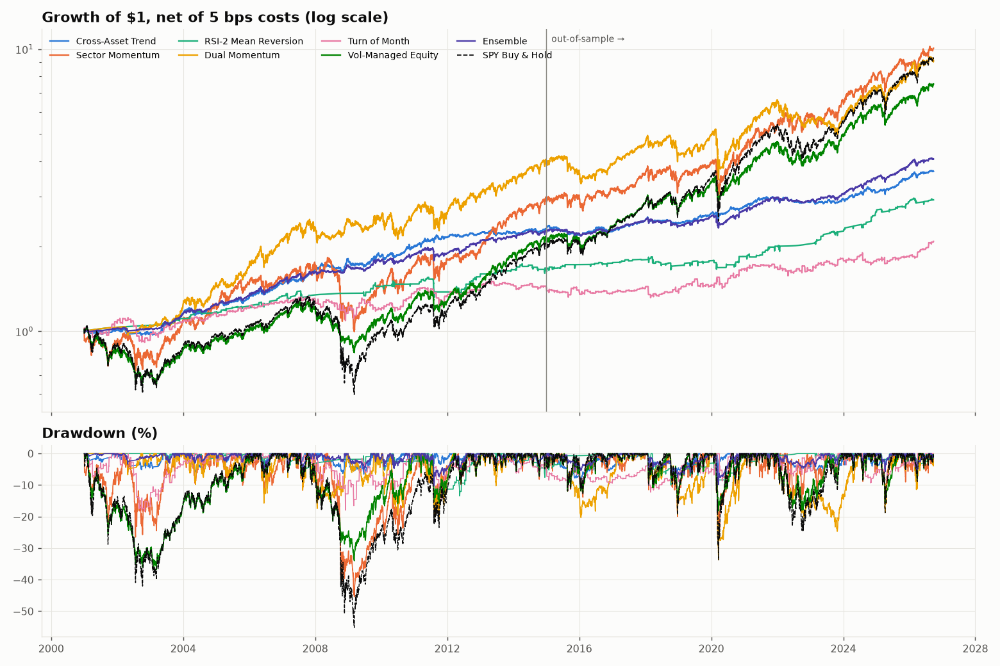
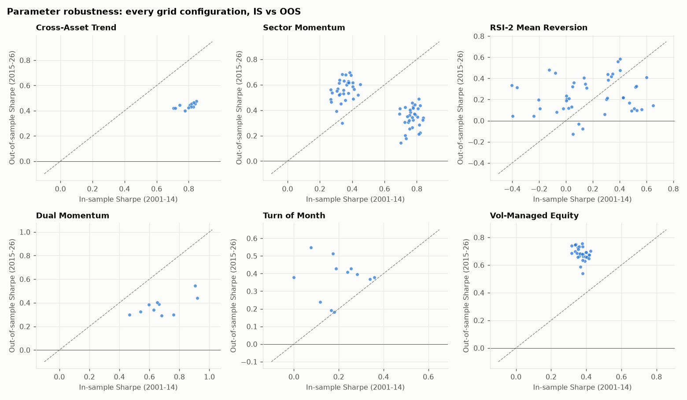
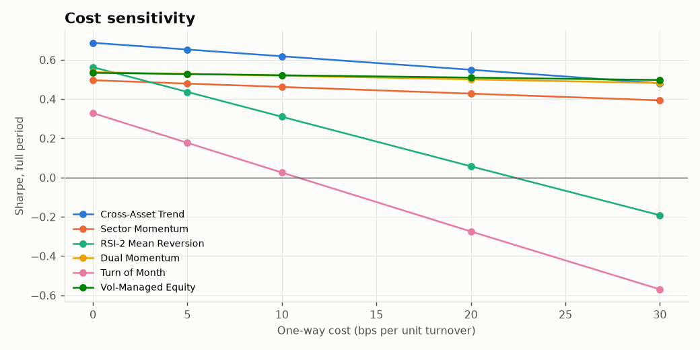
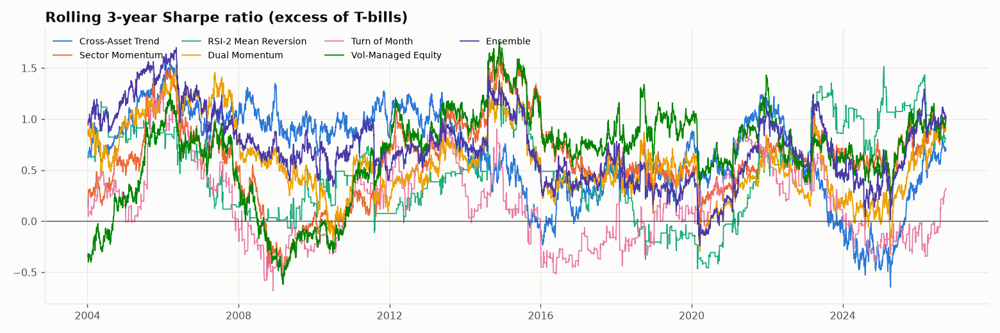
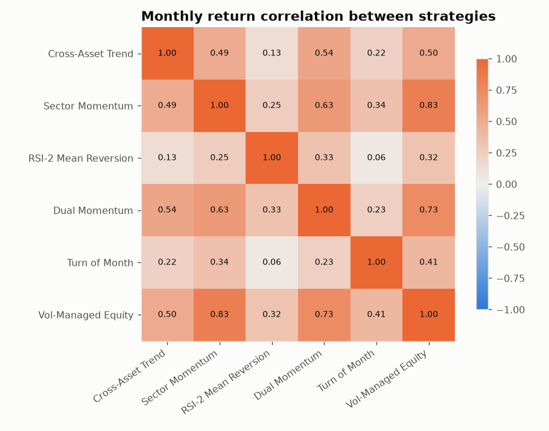

# Systematic Strategy Research: US Equities and Cross-Asset ETFs

**Data as of:** close of 2026-09-25 · **Backtest window:** 2001-01-01 → 2026-09-25
**In-sample (IS):** 2001–2014 · **Out-of-sample (OOS):** 2015–2026-09
**Costs:** 5 bps per unit of one-way turnover (stress-tested to 30 bps) · **Execution:** trade at the *next* close after the signal (1-day lag) unless stated otherwise

> **Scope note.** The prompt left the market open. I chose **US equities, accessed through liquid ETFs** (SPY, the 11 Select Sector SPDRs), plus a cross-asset sleeve (EFA, EEM, TLT, IEF, GLD, DBC, VNQ). The reasons: the data is free and reproducible (Yahoo total-return prices, FRED macro), the history runs 25+ years, and ETF capacity and costs are realistic for a real deployment. Everything reruns with `python run_research.py`.

---

## 1. Executive summary

| | |
|---|---|
| **Strategies tested** | 6 strategy families + 1 negative control, 175 parameter configurations, 2 iterations, 1 pre-registered ensemble → **177 trials** counted in the Deflated Sharpe Ratio |
| **Met the "Sharpe > 1.0 after costs" bar** | **None.** The best full-period Sharpe (excess of T-bills) is 0.69, from the ensemble. No single strategy passes the Deflated Sharpe test at 95% once all 177 trials are counted. |
| **What survived** | Strategies that **cut drawdowns** at a similar or better Sharpe than buy-and-hold, not strategies that beat the market on return |
| **Discarded** | Turn-of-month (costs eat it), overnight drift (costs eat it), RSI-2 as a stand-alone strategy (breaks above ~10 bps of cost) |

**Final ranking (details in §5):**

1. **Cross-Asset Trend (inverse-vol, 4 lookbacks).** Sharpe 0.65, max drawdown **-8%**, beta 0.12, alpha t-stat 2.5. It made money in the GFC (+9.9%). The edge decayed OOS (Sharpe 0.81 IS → 0.43 OOS). It is the most robust result here, and it works as a diversifier, not as a return engine.
2. **Vol-Managed Equity (SPY scaled to 15% vol).** Best OOS Sharpe (0.73 vs SPY 0.71), with max drawdown -37% vs SPY's -55% over the full period. It keeps working at every cost level tested. This is a better way to hold equity beta, not alpha.
3. **Pre-registered ensemble (Trend 42% / RSI-2 41% / Dual Momentum 17%).** Full Sharpe 0.69, max drawdown **-10%**, beta 0.17. Sharpe 0.80 IS → 0.56 OOS. The best overall risk-adjusted profile, but it has low absolute return (5.6% CAGR) unless levered.
4. **Sector Momentum (top-3 by 12-1).** CAGR 9.4% vs SPY 9.1%, but with a -45% drawdown and **negative OOS alpha**. Conditional: use it only as the equity sleeve, not for alpha.
5. **Dual Momentum (SPY/EFA → IEF).** Strong IS (Sharpe 0.66), weak OOS (0.39, alpha t = -1.4). On the watchlist; not recommended.

**Honest bottom line.** Across 2015–2026, a period dominated by US mega-cap equities, SPY buy-and-hold (OOS Sharpe 0.71) was very hard to beat. Most of the "edge" these classic strategies showed in 2001–2014 came from avoiding the 2001–02 and 2008 bear markets. That is real value, but it arrives rarely. The deployable value here is **drawdown control at a near-market Sharpe**, not excess return.

---

## 2. Market analysis (as of 2026-09-25)

Facts below come from price and FRED data (`results/market_overview.csv`, `results/market_macro.json`). Interpretations are labelled as such. **No news or narrative sources were consulted**, so there is no claim about *why* markets are where they are.



| Indicator | Value | Read |
|---|---|---|
| SPY vs 200-day average | **+7.9%**, 0.6% below its all-time high | Uptrend (bull regime) |
| SPY 12m / 6m total return | +17.9% / +20.2% | Strong momentum |
| VIX | **14.9** (20y median 17.1; 8th percentile of the last year) | Low implied vol, complacent pricing |
| 10y / 2y / 3m UST | 5.18% / 4.87% / 4.24% | 10y **+100 bp in 12m**; 10y–3m = +0.94 |
| 10y breakeven → real yield | 2.34% → ~2.8% real | Restrictive real rates |
| CPI y/y, unemployment | 3.7%, 4.1% | Inflation above target, labour market steady |
| HY OAS | 293 bp (42nd percentile since 2016) | Credit is not stressed |
| Sector breadth | **Only 4 of 11 sectors above their 200-day** | Narrow market |
| Equal-weight minus cap-weight, 12m | RSP − SPY = **−4.0 pp** | Mega-cap concentration |
| Leaders (6m) | XLK +48.5%, EEM +23.2%, XLV +18.1%, DBC +14.7% | Tech, EM, commodities |
| Laggards (6m) | XLU −11.6%, TLT −5.7% (−44% from its 2020 high), GLD −1.8% | Duration and rate-sensitive assets |

**Interpretation (not tested):** The index is in a strong uptrend, but leadership is narrow, long yields are rising (a bear-steepening curve), commodities are firm, and implied vol is low. That mix has two consequences:

1. Trend and momentum models are **long equities and commodities and out of bonds** today.
2. Vol-managed equity is at **~91% exposure**. Because realised vol is low, it offers little protection until vol rises; it reacts *after* a shock, not before.

**Current positions of each model** (`results/current_positions.json`):

| Strategy | Target positions |
|---|---|
| Cross-Asset Trend | SPY 13%, EFA 9%, DBC 7%, EEM 6%, VNQ 6%, GLD 3% (**no Treasuries**), ~57% T-bills |
| Sector Momentum | XLK, XLE, XLV (⅓ each) |
| Dual Momentum | 100% SPY |
| Vol-Managed Equity | 91% SPY |
| RSI-2, Turn-of-Month | Flat |

---

## 3. Strategy details

All code is in `elite_research/strategies.py`. The backtester's conventions (`elite_research/engine.py`):

- Signals use only data up to the close of day *t*; trades execute at the close of *t+1*.
- Cash earns the 13-week T-bill rate (^IRX). Leverage above 1× pays T-bill + 1%.
- Costs are charged on actual turnover, including drift between rebalances, which is slightly conservative.

**Default parameters were fixed from the literature before looking at any results.** The grids exist only to test sensitivity.

| # | Strategy | Thesis (why the edge might exist) | Rules (defaults) | Rebalance |
|---|---|---|---|---|
| S1 | **Cross-Asset Trend** | Time-series momentum (Moskowitz–Ooi–Pedersen 2012; Hurst et al. 2017): slow-moving capital, under-reaction, and hedging demand | Score each of 8 ETFs by the fraction of {1, 3, 6, 12}-month lookbacks on which it beat T-bills. Weight = score × inverse 63-day vol share. Remainder in T-bills. | Monthly |
| S2 | **Sector Momentum** | Industry momentum (Moskowitz–Grinblatt 1999): slow diffusion of sector-wide news, flow-chasing | Equal-weight the top 3 of 11 sector ETFs by 12-month return skipping the last month | Monthly |
| S3 | **RSI-2 Mean Reversion** | Liquidity provision: short-horizon overreaction to forced selling reverts | Buy SPY when RSI(2) < 10 and SPY > its 200-day average. Exit when close > 5-day SMA, or after 10 days. | Daily |
| S4 | **Dual Momentum** | Relative plus absolute momentum (Antonacci 2014) | Hold the better of SPY/EFA by 12-month return if it beats T-bills; otherwise IEF | Monthly |
| S5 | **Turn of Month** | Month-end pension, payroll and 401(k) flows (Ariel 1987; Etula et al. 2020) | Long SPY on the last trading day and the first 3 trading days of each month; T-bills otherwise | Calendar |
| S6 | **Vol-Managed Equity** | Vol clusters but predicts returns only weakly (Moreira–Muir 2017) | SPY weight = min(1, 15% / 20-day realised vol), with a 10-pp no-trade band | Daily (band) |
| S7 | **Overnight drift** *(negative control)* | Returns concentrate overnight (Cliff–Cooper–Gulen 2008) | Buy SPY at the close, sell at the next open, every day | Daily |

Benchmarks: SPY buy-and-hold, 60/40 SPY/IEF, and equal-weight sectors (all charged the same costs).

---

## 4. Backtest results



### 4.1 Full period, 2001-01 → 2026-09 (net of 5 bps)

Sharpe and Sortino are measured on returns in excess of T-bills. Alpha t-stat is versus SPY.

| Strategy | CAGR | Vol | Sharpe | Sortino | Max DD | Calmar | Mo. win % | Profit factor | Beta | Alpha t | Turnover/yr |
|---|---|---|---|---|---|---|---|---|---|---|---|
| Cross-Asset Trend | 5.2% | 5.3% | **0.65** | 0.92 | **−8.1%** | **0.64** | 66% | **2.21** | 0.12 | **2.54** | 3.6× |
| Sector Momentum | **9.4%** | 18.8% | 0.48 | 0.67 | −45.4% | 0.21 | 63% | 1.67 | 0.87 | 0.80 | 6.4× |
| RSI-2 Mean Reversion | 4.3% | 5.9% | 0.44 | 0.62 | −15.1% | 0.28 | **81%** | 2.51 | 0.10 | 1.57 | 15.0× |
| Dual Momentum | 9.0% | 15.1% | 0.53 | 0.73 | −33.7% | 0.27 | 64% | 1.76 | 0.49 | 1.58 | 2.8× |
| Turn of Month | 2.9% | 8.0% | 0.18 | 0.25 | −18.3% | 0.16 | 60% | 1.39 | 0.18 | −0.08 | 24.1× |
| Vol-Managed Equity | 8.2% | 13.2% | 0.53 | 0.73 | −36.8% | 0.22 | 64% | 1.68 | 0.64 | 1.36 | 1.6× |
| **Ensemble (pre-registered)** | 5.6% | 5.6% | **0.69** | **0.98** | −10.3% | 0.55 | – | – | 0.17 | **2.62** | 8.1× |
| *SPY Buy & Hold* | *9.1%* | *19.0%* | *0.46* | *0.65* | *−55.2%* | *0.16* | *65%* | *1.63* | *1.00* | – | – |
| *60/40 SPY/IEF* | *6.6%* | *11.9%* | *0.45* | *0.64* | *−40.9%* | *0.16* | *66%* | *1.71* | *0.60* | – | – |
| *EW Sectors* | *9.0%* | *18.1%* | *0.47* | *0.66* | *−52.6%* | *0.17* | *65%* | *1.65* | *0.92* | – | – |

Trade statistics for the discrete-trade strategies:

- **RSI-2:** 192 trades, 69% win rate, +0.40% average trade, 3.4-day average hold.
- **Turn of Month:** 310 trades, 55% win rate, +0.1% average trade.

### 4.2 In-sample vs out-of-sample

| Strategy | Sharpe IS (2001–14) | Sharpe OOS (2015–26) | CAGR IS | CAGR OOS | Max DD OOS | OOS alpha t |
|---|---|---|---|---|---|---|
| Cross-Asset Trend | 0.81 | 0.43 | 6.2% | 4.1% | −8.1% | 0.26 |
| Sector Momentum | 0.41 | 0.57 | 8.0% | 11.2% | −31.1% | −0.50 |
| RSI-2 Mean Reversion | 0.40 | 0.48 | 3.8% | 4.9% | −10.0% | 0.85 |
| Dual Momentum | 0.66 | 0.39 | 10.5% | 7.3% | −33.7% | −1.44 |
| Turn of Month | 0.17 | 0.19 | 2.6% | 3.3% | −9.3% | −0.40 |
| Vol-Managed Equity | 0.36 | **0.73** | 5.6% | 11.3% | −18.2% | 0.70 |
| Ensemble | 0.80 | 0.56 | 6.0% | 5.1% | −9.8% | 0.11 |
| *SPY* | *0.28* | *0.71* | *5.2%* | *13.8%* | *−33.7%* | – |
| *60/40* | *0.31* | *0.67* | *4.7%* | *8.9%* | *−21.1%* | – |

**Reading this table.** The two periods are different regimes:

- **IS** contains two -50% equity bear markets. Defensive and trend strategies beat SPY there by a wide margin.
- **OOS** is an equity bull market with short V-shaped corrections (2018, COVID, 2025). Trend-following strategies re-enter late and lose relative ground in that environment.

No strategy produced significant alpha against SPY out-of-sample (every |t| < 1.5).

### 4.3 Statistical significance and data-snooping control

`results/significance.csv`

| Strategy | PSR (Sharpe > 0) | **Deflated Sharpe (177 trials)** | Bootstrap 90% CI of Sharpe |
|---|---|---|---|
| Cross-Asset Trend | 0.999 | **0.28** | [0.37, 0.96] |
| Dual Momentum | 0.996 | 0.12 | [0.24, 0.84] |
| Vol-Managed Equity | 0.996 | 0.12 | [0.24, 0.83] |
| Sector Momentum | 0.992 | 0.07 | [0.23, 0.78] |
| RSI-2 Mean Reversion | 0.985 | 0.05 | [0.16, 0.74] |
| Turn of Month | 0.81 | 0.00 | [−0.14, 0.49] |
| *SPY* | *0.990* | – | *[0.18, 0.76]* |

- **PSR (probabilistic Sharpe ratio):** every strategy except TOM has a Sharpe reliably above zero.
- **Deflated Sharpe:** none clears 0.95, the level at which we could be confident its Sharpe beats the best result you would expect from 177 attempts on noise.
- Every strategy's bootstrap confidence interval overlaps SPY's. **We cannot statistically distinguish these strategies' Sharpe ratios from buy-and-hold's.** The drawdown differences are large and structural; the Sharpe differences are not significant.

---

## 5. Robustness, iteration and ranking

### 5.1 Parameter sensitivity (every grid configuration, IS vs OOS)



| Strategy | # configs | Median Sharpe IS → OOS | % configs OOS Sharpe > 0 | Best-IS config: Sharpe IS → OOS | Rank corr. IS/OOS | Walk-forward Sharpe OOS | Default Sharpe OOS |
|---|---|---|---|---|---|---|---|
| Cross-Asset Trend | 12 | 0.81 → 0.44 | 100% | 0.85 → 0.48 | **+0.83** | 0.42 | 0.43 |
| Sector Momentum | 64 | 0.57 → 0.45 | 100% | 0.84 → **0.34** | **−0.62** | 0.49 | 0.57 |
| RSI-2 | 45 | 0.14 → 0.22 | 93% | 0.65 → **0.14** | 0.16 | 0.15 | 0.48 |
| Dual Momentum | 10 | 0.66 → 0.36 | 100% | 0.92 → 0.44 | 0.47 | 0.31 | 0.39 |
| Turn of Month | 12 | 0.18 → 0.39 | 100% | 0.36 → 0.38 | −0.06 | 0.52 | 0.19 |
| Vol-Managed Equity | 32 | 0.38 → 0.68 | 100% | 0.42 → 0.70 | −0.49 | 0.68 | 0.73 |

What the grid shows:

- **Optimising parameters did not help.** For Sector Momentum and RSI-2, the best in-sample configuration did clearly *worse* OOS than the literature defaults. A negative rank correlation means the IS ranking was anti-informative. That is the textbook sign that picking parameters would have been curve-fitting.
- **Cross-Asset Trend is the one family where the IS parameter ranking carried over** (rank correlation +0.83), and every configuration was profitable OOS.
- **Walk-forward** (each January, pick the config with the best trailing 5-year Sharpe) never beat the fixed defaults by a meaningful margin, and for RSI-2 it was much worse.

### 5.2 Cost and execution stress



| Full-period Sharpe | 0 bps | 5 bps | 10 bps | 20 bps | 30 bps | Lag 0d (MOC) | Lag 2d |
|---|---|---|---|---|---|---|---|
| Cross-Asset Trend | 0.69 | 0.65 | 0.62 | 0.55 | 0.48 | 0.71 | 0.63 |
| Vol-Managed Equity | 0.53 | 0.53 | 0.52 | 0.51 | 0.50 | 0.53 | 0.51 |
| Dual Momentum | 0.54 | 0.53 | 0.52 | 0.50 | 0.48 | 0.52 | 0.53 |
| Sector Momentum | 0.50 | 0.48 | 0.46 | 0.43 | 0.39 | 0.50 | 0.49 |
| RSI-2 | 0.56 | 0.44 | 0.31 | **0.06** | **−0.19** | 0.49 | 0.46 |
| Turn of Month | 0.33 | 0.18 | **0.03** | **−0.27** | −0.57 | 0.18 | 0.01 |

**Overnight drift (negative control):** Sharpe 0.62 gross, 0.17 at 1 bp per side, and −1.64 at 5 bps per side (a -99% drawdown). The anomaly exists on paper and is untradeable at retail or institutional cost. This result is included to show that the cost model does real work.

### 5.3 Regimes and crises

Returns over each crisis window (`results/crisis_returns.csv`):

| | Dot-com | GFC | 2011 | 2015–16 | Q4 2018 | COVID | 2022 | 2025 tariffs |
|---|---|---|---|---|---|---|---|---|
| Cross-Asset Trend | −2.0% | **+9.9%** | +0.6% | −1.7% | −2.6% | −3.5% | −3.4% | −3.8% |
| Ensemble | +2.0% | +5.3% | −6.8% | −2.8% | −5.3% | −9.2% | −4.0% | −5.6% |
| Vol-Managed Equity | −34.3% | −33.4% | −15.5% | −12.3% | −14.9% | −17.8% | −17.5% | −15.5% |
| Dual Momentum | +5.4% | −0.9% | −20.7% | −14.8% | −18.7% | −33.4% | −17.6% | −18.6% |
| Sector Momentum | −26.7% | −41.6% | −19.4% | −13.6% | −18.5% | −31.1% | −3.7% | −15.3% |
| *SPY* | *−39.1%* | *−54.8%* | *−18.4%* | *−13.0%* | *−18.7%* | *−33.4%* | *−24.1%* | *−18.6%* |
| *60/40* | *−33.2%* | *−31.1%* | *−6.3%* | *−5.1%* | *−10.4%* | *−18.9%* | *−20.6%* | *−10.4%* |

- **Slow monthly signals do not protect against fast crashes.** Dual Momentum took the full COVID drawdown (−33.4%, the same as SPY) because it could only exit after the fact.
- **Trend is the only strategy that stayed positive or near flat in every episode.**
- **In 2022** stocks and bonds fell together, which broke 60/40 (−20.6%). Trend lost only −3.4% because its Treasury holdings had already exited.



### 5.4 Correlation and diversification



Sector Momentum, Dual Momentum and Vol-Managed Equity are all equity beta in different wrappers (pairwise monthly correlations 0.63–0.83). RSI-2 (0.13 vs trend) and Cross-Asset Trend are the real diversifiers, which is why the pre-registered ensemble has the best overall profile.

**Ensemble rule, fixed using in-sample information only:** include a strategy if its IS Sharpe > 0.3 and IS max drawdown > −35%; weight by inverse IS volatility. The rule selected Trend (42%), RSI-2 (41%) and Dual Momentum (17%).

### 5.5 Iteration round (evidence-driven, counted as trials)

| Variant | Why | Sharpe IS → OOS | Max DD (full) | Verdict |
|---|---|---|---|---|
| Trend levered to 10% vol (≤ 2×) | Trend runs at only 5% vol | 0.78 → 0.40 | −15.3% | CAGR 7.4%, but financing cost lowers Sharpe (0.65 → 0.61). Use only if the mandate needs the return. |
| Sector Momentum + vol overlay (15%) | Momentum crash risk (Barroso & Santa-Clara 2015) | 0.49 → 0.44 | **−29.5%** (from −45.4%) | Drawdown fixed, Sharpe unchanged. Prefer this over raw sector momentum if it is used at all. |
| 50/50 blend of the two above *(post-hoc, chose after seeing OOS)* | Combine diversifier and equity sleeve | 0.69 → 0.47 | −19.0% | No improvement over the clean ensemble. Discarded. |

### 5.6 Composite ranking

`results/ranking.csv`: the average rank across full Sharpe, OOS Sharpe, walk-forward OOS Sharpe, grid robustness, OOS Sharpe at 20 bps, max drawdown, alpha t-stat and Deflated Sharpe.

| Rank | Strategy | Score | Verdict |
|---|---|---|---|
| 1 | Cross-Asset Trend | 4.63 | ✅ **Deploy** (diversifier / crisis hedge) |
| 2 | Vol-Managed Equity | 4.38 | ✅ **Deploy** (replaces passive equity beta) |
| – | Ensemble (Trend + RSI-2 + Dual Mom) | – | ✅ **Deploy** as a low-vol absolute-return sleeve, *if* RSI-2 can execute at ≤ 5 bps |
| 3 | Dual Momentum | 3.75 | ⚠️ Watchlist: decayed OOS, whipsaws in V-shaped markets |
| 4 | Sector Momentum | 3.38 | ⚠️ Conditional: only with a vol overlay, as an equity sleeve; no demonstrated alpha OOS |
| 5 | RSI-2 Mean Reversion | 2.63 | ❌ Stand-alone (cost-fragile); ✅ as an ensemble component with cheap MOC execution |
| 6 | Turn of Month | 2.25 | ❌ Discard: edge < costs |
| – | Overnight drift | – | ❌ Discard: edge ≪ costs |

---

## 6. Final recommendations

**Portfolio A: "better beta" (for an equity-allocation mandate)**

- **70% Vol-Managed Equity + 30% Cross-Asset Trend.**
- Why: it keeps most of the equity upside and roughly halves crisis drawdowns (trend was +9.9% in the GFC while vol-managed equity lost −33%). The two correlate only 0.50 monthly.
- Backtest (`results/portfolio_a_metrics.csv`; the mix was chosen after seeing results, so treat these numbers as illustrative):

  | | CAGR | Vol | Sharpe | Max DD | Beta |
  |---|---|---|---|---|---|
  | Full period | 7.4% | 10.2% | 0.58 | **−27.7%** (SPY −55.2%) | 0.48 |
  | OOS 2015–26 | 9.2% | 10.0% | 0.73 (SPY 0.71) | −14.0% (SPY −33.7%) | 0.52 |

  GFC −22% vs SPY −55%; COVID −14% vs −33%; 2022 −13% vs −24%.

**Portfolio B: "absolute return" (for a low-vol mandate)**

- **The pre-registered ensemble: Trend 42% / RSI-2 41% / Dual Momentum 17%.**
- Target 5–6% vol unlevered, or scale to 8–10% vol with ≤ 1.75× gross if financing is cheap.

**Do not deploy:** turn-of-month, overnight drift, or RSI-2 on its own.

---

## 7. Deployment considerations

- **Instruments and capacity.** All ETFs trade $0.5bn–$30bn+ per day, so capacity is effectively unconstrained below ~$500m. Use MOC orders. At realistic 1–3 bps all-in costs for SPY-class ETFs, the 5 bps assumption leaves margin.
- **Schedule.**
  - Monthly strategies: compute on the last trading day's close, execute at the next close.
  - Vol-managed: check daily; trade only when the target moves more than 10 pp.
  - RSI-2: signals at the close, MOC execution the same or next day. It is the one sleeve where execution quality decides profitability; it breaks even around 20 bps.
- **Sizing.** Risk-budget sleeves by volatility, not by capital. Trend's 5% vol means a 30% capital weight is only about 10% of portfolio risk. If leverage is used, cap gross at 2×, and remember that financing at T-bill + 1% costs about 0.05 Sharpe (§5.5).
- **Taxes.** Turnover is 1.5–15× per year, so gains are mostly short-term. Prefer tax-advantaged accounts.
- **Monitoring and kill switches.** Review a strategy (don't auto-kill it) if any of these happen:
  1. Its drawdown exceeds **1.5× the backtest maximum**: Trend > 12%, ensemble > 15%, vol-managed equity > 55%.
  2. Its rolling 3-year Sharpe falls below −0.3.
  3. Realised turnover or costs run more than 2× the backtest.
  4. Live results diverge from a shadow backtest by more than 2% per year (a sign of an implementation error).
- **Rebalance drift.** The engine rebalances to target daily and charges for it. Live, you can let positions drift between monthly rebalances, which slightly reduces cost.

---

## 8. What could go wrong

**Key risks**

1. **The edge decays.** Every strategy here was published before or during the OOS window. OOS Sharpe fell by 30–50% for Trend and Dual Momentum. Assume live Sharpe ≈ OOS Sharpe or lower, not the full-period figure.
2. **V-shaped crashes.** Monthly trend and momentum signals exit after the damage (COVID: Dual Momentum −33%). Vol-managed equity cuts only after vol spikes. A one-day gap crash (1987-style) is **not hedged** by anything here.
3. **Stock–bond correlation stays positive.** This happened in 2022 and is plausible in today's rising-yield regime. It removes the bond leg that trend and risk-parity-style books rely on. Trend handled 2022 by leaving bonds, but its diversification is lower when commodities are the only non-equity trend.
4. **The current regime is unfavourable for trend.** The low-VIX, narrow, mega-cap-led market resembles 2017–2019 and 2023–24, when trend and defensive strategies lagged SPY badly. Expect long stretches of underperformance against the S&P 500. **That is the price of the drawdown protection, and it is the main behavioural risk of abandoning the strategy at the wrong time.**
5. **Crowding.** Trend and vol-targeting are widely run by CTAs and risk-parity funds. Their deleveraging can amplify the very moves the strategies react to.

**What would invalidate each thesis**

| Strategy | Invalidation |
|---|---|
| Trend | Rolling 5-year Sharpe < 0 across *all* 12 grid configurations, meaning the edge is gone rather than just this parameterisation failing |
| Vol-managed equity | Realised vol starts to *positively* predict next-month returns (test by regressing monthly SPY returns on lagged vol) |
| RSI-2 | Win rate falls below 60%, or average trade falls below 2× round-trip cost, over 50+ trades |

**Limitations of this study**

- **Short history.** Pre-2004, the trend universe is only SPY, EFA and Treasuries, and ETF data before 2001 is too short. A longer study should splice index or futures proxies back to the 1970s or earlier.
- **Tested universe.** Only US-listed ETFs were tested. Single stocks, options, and factor long-short strategies were out of scope.
- **Cost model.** Costs are a flat per-turnover estimate. There is no market-impact model (not needed at ETF scale), no borrow modelling beyond T-bill + 1%, and no taxes.
- **Data.** Yahoo adjusted closes are generally reliable. One quirk was found and fixed: ^VIX carries prints on two 2026 exchange holidays, which had silently zeroed the trend signal. The calendar is now anchored to SPY sessions, and an interior-gap assertion guards against this.
- **Hindsight in the universe.** The ETF list reflects what is known to be liquid today, a mild selection effect. Sector ETFs have no survivorship bias.
- **Interpretation.** The market narrative in §2 is inferred from price and macro data only.

---

## Appendix: reproducing and extending

```bash
pip install -r requirements.txt
python run_research.py            # uses cached data in data/ if present
python run_research.py --refresh  # re-download prices and macro series
```

| File | Contents |
|---|---|
| `elite_research/data.py` | Yahoo/FRED loaders with an on-disk cache |
| `elite_research/engine.py` | Vectorised backtester (lag, costs, cash, leverage financing, turnover) |
| `elite_research/metrics.py` | CAGR, Sharpe, Sortino, drawdown, alpha/beta, PSR, Deflated Sharpe, block-bootstrap CI |
| `elite_research/strategies.py` | All strategy signal generators and the vol-target overlay |
| `run_research.py` | The full pipeline. Change `END`, `IS_END` and `COST_BPS` at the top. Add a strategy by adding one entry to `STRATEGIES`. |
| `results/*.csv`, `results/*.json` | Every number in this report |
| `results/charts/` | Figures |
